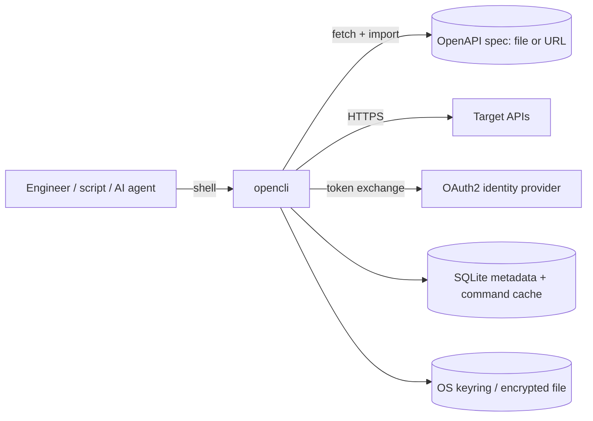

# OpenCLI Architecture

## Purpose

OpenCLI is a cross-platform CLI that turns imported OpenAPI documents into commands at runtime. Engineers, scripts and AI agents register an API once (`opencli api add crm`) and then call its operations (`opencli crm users get 123`). Nothing is regenerated or recompiled when specs change. The imported spec is the source of truth. See the [PRD](../PRD.md).

## Context

## Workspace layout

Crates are added in the milestone that needs them, so the workspace never holds empty crates.

| Crate | Responsibility | Depends on | Milestone |
|---|---|---|---|
| `opencli` | Binary: clap root, wiring the dependencies together, output rendering | all | 0 |
| `opencli-core` | Domain model (`ApiName`, `ApiSpec`, `Operation`, `Parameter`, `SecurityScheme`) and command naming. Interfaces are added only where a second implementation or test double exists (e.g. `CredentialStore` in M4) | none | 1 |
| `opencli-spec` | Parses OpenAPI 3.0/3.1 and Swagger 2.0 (3.1 and 2.0 rewritten to 3.0 form first) → domain model; semantic validation | core | 1, 6 |
| `opencli-store` | SQLite via sqlx, migrations, command-tree cache file | core | 1 |
| `opencli-runtime` | Turns a command and its argument values into a request plan (M2); sends it with reqwest (M3) | core | 2–3 |
| `opencli-auth` | Keyring and encrypted-file credential stores; credential selection; OAuth 2.0 grants, PKCE and the loopback redirect | core, runtime | 4 |
| `opencli-plugin` | `plugin.toml` manifests (aliases, table formats, credential providers), alias expansion, column rendering, `opencli-<name>` discovery on `PATH`, provider execution | core | 8 |

Dependency rule: everything depends inward on `opencli-core`, and `opencli-core` depends on nothing. Only the binary knows about every crate.

## Key flows

**Add an API.** `opencli api add crm` asks for a file or URL (or takes `--spec`). The spec loader detects the format and the matching adapter builds the domain model. Validation errors are reported with miette, pointing at the location in the spec. The store saves a new spec version, the command naming rules ([ADR 0002](adr/0002-command-surface.md)) run, and the command-tree cache is rebuilt.

**Run an operation.** `opencli crm users get 123`. The dispatcher finds `crm` among the arguments and loads only that API's cached `CommandSet`, rebuilding it from the store if the cache is missing. It turns the set into a clap subtree, parses the arguments, and finds the matching command. `opencli-runtime` turns the values into a `RequestPlan`, which `--dry-run` prints. The credential store supplies auth for the operation's security requirement, refreshing the token if it has expired. The runtime builds the request (path, query, header and body) and sends it with timeouts and TLS verification on. The response is printed as a table or JSON, and the exit code reflects the HTTP status class (ADR 0002).

**Refresh.** `opencli api refresh crm [--spec <new-source>] [--dry-run]` loads the spec again from its source (or from a new one) and validates it. It rebuilds the commands, failing on naming conflicts, and diffs them against the current version by operation (method and path): commands added, removed, renamed or changed, plus security scheme changes, with breaking changes flagged. Identical content changes nothing. Content seen before reactivates that version (`apis.current_version_id`). Anything else adds a version. The command cache is rewritten. Credentials are keyed by API and scheme name, so they carry over, except for schemes the new version drops, which are deleted.

## Cross-cutting

- **Auth:** API key (header, query or cookie), HTTP basic, bearer, and OAuth 2.0 client credentials or authorization code with PKCE. For each call, the first security alternative whose schemes all have credentials (from the environment or the store) is used. An empty alternative means anonymous access is allowed. Storage and environment overrides: [ADR 0004](adr/0004-credential-storage.md). OAuth: [ADR 0007](adr/0007-oauth-without-oauth2-crate.md).
- **Observability:** `tracing` to stderr. The default level is `warn`. `-v` shows debug logs, with per-phase timings: command load, planning, credential resolution, and the request. `RUST_LOG` overrides both.
- **Audit:** `audit.log` in the data directory, as JSON lines (`0600`, rotated to `audit.log.1` past 10 MiB). It records API calls (API, command, method, URL without query, status, outcome, duration, and the scheme *names* used) and `api add/refresh/remove` and `auth login/logout`. It never records secrets or query strings. `OPENCLI_AUDIT=off` disables it. Writing it is best effort, so a failure is logged and never fails the command.
- **Plugins:** [ADR 0005](adr/0005-plugin-model.md). Aliases expand before parsing. A plugin format replaces the table for one command. Credential providers come between the environment and the store. An `opencli-<name>` executable runs when no API has that name.
- **Terminal UX:** a spinner on stderr for spec loads, token requests and API calls, and colored table headers and diff labels. Both appear only on a terminal, and colors respect `NO_COLOR`. Pipes and scripts get plain, stable output.
- **Config/secrets:** Config files live in the platform config directory (via `directories`). Secrets live only in the credential store.
- **Transport:** TLS verification is always on, and there's deliberately no option to turn it off. Connect timeout is 10 s. The request timeout is 30 s by default (`--timeout`). Redirects are capped at 5, and responses are capped at 64 MiB. Plain `http://` to a host other than localhost logs a warning. Query strings and headers are never logged, because they may carry credentials.
- **Delivery:** Azure Pipelines on Linux, macOS and Windows. The gate is fmt, clippy `-D warnings`, test, cargo-deny, and at least 80% line coverage.

## Expected load and constraints

This is a single-user local process. Startup latency is the metric that matters. Target: under 50 ms to dispatch a command when the cache is warm, with specs of up to about 2,000 operations.

## Decisions

See [docs/adr/](adr/):

1. [Specification-driven runtime with an internal domain model](adr/0001-spec-driven-runtime.md)
2. [Command surface: API name first](adr/0002-command-surface.md)
3. [Metadata store and command cache](adr/0003-metadata-store.md)
4. [Credential storage](adr/0004-credential-storage.md)
5. [Plugin model](adr/0005-plugin-model.md)
6. [No built-in AI provider](adr/0006-no-built-in-ai.md)
7. [OAuth 2.0 flows without the `oauth2` crate](adr/0007-oauth-without-oauth2-crate.md)
8. [`sqlx` with hand-written SQL instead of an ORM](adr/0008-sqlx-instead-of-an-orm.md)
