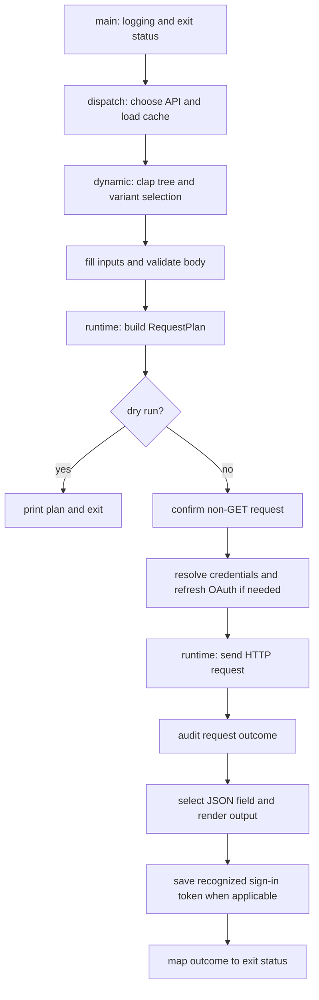

# Development and internals

[Documentation home](README.md) · [Architecture](architecture.md)

## Build and run from source

Rust is pinned in [`rust-toolchain.toml`](../rust-toolchain.toml); the workspace
uses edition 2024. Dependency declarations and shared lints live in the root
[`Cargo.toml`](../Cargo.toml). Install the pinned toolchain through rustup and
the native C build tools, then run from the repository root:

```sh
rustup run 1.99.1 cargo build --workspace --all-targets
rustup run 1.99.1 cargo run -p opencli -- --help
```

Using the rustup-selected Cargo also avoids a Homebrew Cargo/rustc mismatch
when using target-specific standard libraries or coverage tools.

For an isolated development session in a POSIX shell:

```sh
export OPENCLI_HOME="$(mktemp -d)"
export OPENCLI_CREDENTIAL_STORE=file
export OPENCLI_PASSPHRASE=local-development-only
rustup run 1.99.1 cargo run -p opencli -- \
  --server https://example.com api add demo --spec ./fixtures/petstore.yaml
rustup run 1.99.1 cargo run -p opencli -- demo pets --dry-run
unset OPENCLI_HOME OPENCLI_CREDENTIAL_STORE OPENCLI_PASSPHRASE
```

The passphrase above is public test data for a disposable directory, never for
real credentials. A temporary home alone does not isolate the OS keyring.
Use the file store as well for tests and experiments.

## Follow a request through the source



1. [`main.rs`](../crates/opencli/src/main.rs) initializes `tracing` from `-v` and
   `RUST_LOG`, then calls dispatch. Diagnostics use stderr; exit codes are
   defined by [`error.rs`](../crates/opencli/src/error.rs).
2. [`dispatch.rs`](../crates/opencli/src/dispatch.rs) resolves data paths and
   identifies the requested registration. It loads that API's command tree,
   discovers manifest plugins, expands aliases and combines dynamic commands
   with the built-in clap root. A missing registration can dispatch to an
   `opencli-<name>` executable plugin.
3. [`cache.rs`](../crates/opencli/src/cache.rs) checks cache format, executable
   version and API identity. A missing/incompatible cache opens the metadata
   store, rebuilds commands from the stored spec and writes a new cache. Normal
   dispatch does not need to reread the source file or fetch the source URL.
4. [`dynamic.rs`](../crates/opencli/src/dynamic.rs) builds the clap tree and
   groups operations into variants. Path flags select a variant. It rejects
   flags that do not apply, gathers arguments/body and delegates terminal input
   to [`fill.rs`](../crates/opencli/src/fill.rs).
5. [`plan.rs`](../crates/opencli-runtime/src/plan.rs) maps domain arguments to
   path substitutions, query pairs, headers, cookies and body values.
   [`body.rs`](../crates/opencli-core/src/body.rs) checks supported body schema
   constraints before sending or printing a dry run. `--describe` exits with
   the structured contract; dry runs exit before credential resolution.
6. For a real write, confirmation happens before authorization and sending.
   Credential sources are combined in the binary. The auth crate's
   [`authorize.rs`](../crates/opencli-auth/src/authorize.rs) selects a security
   alternative and places credentials; OAuth renewal uses
   [`oauth.rs`](../crates/opencli-auth/src/oauth.rs). Blocking keyring and file
   encryption work is offloaded through
   [`credentials.rs`](../crates/opencli/src/credentials.rs).
7. [`send.rs`](../crates/opencli-runtime/src/send.rs) constructs the reqwest
   request, attaches sensitive credential placements, encodes/uploads the body
   and buffers the bounded response. It classifies transport errors while HTTP
   error statuses remain response values for the CLI to render.
8. [`audit.rs`](../crates/opencli/src/audit.rs) records the outcome without
   query strings, headers or secrets. [`output.rs`](../crates/opencli/src/output.rs)
   selects response fields and renders generic JSON/tables; plugin columns can
   supply a different table. HTTP status failures are reported after the body.
   A detected successful sign-in can save its token and emit a stderr notice.

## Import and refresh flow

[`commands/api.rs`](../crates/opencli/src/commands/api.rs) coordinates import:

- [`source.rs`](../crates/opencli/src/source.rs) reads a bounded UTF-8 file or
  permitted URL and saves its canonical source location.
- [`opencli-spec`](../crates/opencli-spec/src/lib.rs) detects JSON/YAML and
  OpenAPI/Swagger version. Format adapters normalize into the internal model;
  semantic validation runs before persisting.
- [`naming.rs`](../crates/opencli-core/src/naming.rs) and
  [`commands.rs`](../crates/opencli-core/src/commands.rs) derive command words,
  variants and arguments. Conflicts fail before a registration is stored.
- [`opencli-store`](../crates/opencli-store/src/store.rs) saves metadata, parsed
  and original specs and version history in SQLite using literal SQL with bound
  parameters. Store migrations live in
  [`migrations/`](../crates/opencli-store/migrations).
- The binary writes/invalidates the command cache and records an audit event.

Refresh reuses this path, compares the old/new command model through
[`diff.rs`](../crates/opencli-core/src/diff.rs), and chooses unchanged,
reactivated or new content. It retains local server/credential-link settings
and removes credentials for schemes the new spec drops.

## Authentication boundaries

[`sign_in.rs`](../crates/opencli-core/src/sign_in.rs) contains pure convention
rules: detecting login operations, token-compatible schemes and token fields.
It does not read a keyring or send HTTP. The binary decides when to ask for a
sign-in, save tokens or follow `credentials_from` links. The auth crate owns
credential representations, selection, stores and OAuth grants.

The encrypted file store uses Argon2id and ChaCha20-Poly1305; the OS store uses
keyring service `opencli` with account `<api>/<scheme>`. Credential values are
`SecretString`s until request placement. See
[authentication](authentication.md) for precedence and the important difference
between stored OAuth grants and convention-detected access tokens.

## Where a change belongs

| Change | Starting points |
|---|---|
| Built-in flag/command | [`cli.rs`](../crates/opencli/src/cli.rs), [`commands/`](../crates/opencli/src/commands) |
| Generated naming or parameters | [`naming.rs`](../crates/opencli-core/src/naming.rs), [`commands.rs`](../crates/opencli-core/src/commands.rs) |
| Body prompts or validation | [`fill.rs`](../crates/opencli/src/fill.rs), [`body.rs`](../crates/opencli-core/src/body.rs) |
| Import a spec construct | [`opencli-spec/src/`](../crates/opencli-spec/src) and fixtures |
| Change metadata | [`store.rs`](../crates/opencli-store/src/store.rs) and a new migration |
| Request encoding/sending | [`opencli-runtime/src/`](../crates/opencli-runtime/src) |
| Token/store behavior | [`opencli-auth/src/`](../crates/opencli-auth/src), binary credentials/auth wiring |
| Alias, table provider, executable discovery | [`opencli-plugin/src/`](../crates/opencli-plugin/src) |
| Generic response output | [`output.rs`](../crates/opencli/src/output.rs) |
| Packaging/install | [`build.sh`](../build.sh), [`install.sh`](../install.sh), shell tests |

Keep `opencli-core` free of I/O and other workspace dependencies. Parser-library
imports stay in `opencli-spec`. Version declarations belong in
`[workspace.dependencies]`; members use workspace dependencies. Do not introduce
new layers or abstractions without a current need. Read project instructions
and [architecture decisions](architecture.md#decisions) before changing boundaries.

Any change to cached command shape or naming rules needs a `CACHE_FORMAT` bump
in `cache.rs`. Registration writes must also refresh/invalidate cache and write
an audit event. A metadata schema change needs a new versioned migration and
upgrade tests. Keep secrets out of arguments, logs, audit records and fixtures.

## Tests and delivery checks

Run the pinned toolchain from the root:

```sh
rustup run 1.99.1 cargo build --workspace --all-targets
rustup run 1.99.1 cargo fmt --all --check
rustup run 1.99.1 cargo clippy --workspace --all-targets -- -D warnings
rustup run 1.99.1 cargo test --workspace
rustup run 1.99.1 cargo deny check
shellcheck build.sh install.sh tests/build_test.sh tests/install_test.sh
bash tests/build_test.sh
bash tests/install_test.sh
rustup run 1.99.1 cargo llvm-cov --workspace --fail-under-lines 80
```

`cargo-deny`, `cargo-llvm-cov` and ShellCheck must be installed separately;
`llvm-tools-preview` is in the pinned Rust components. The checks must finish
without errors or warnings. Coverage must be at least 80% lines. Formatting a
change uses `cargo fmt --all` before running the check.

Unit tests live with source or in crate test targets. Binary integration tests
are in [`crates/opencli/tests/`](../crates/opencli/tests). They use temporary
`OPENCLI_HOME`, file credentials and test passphrases rather than your keyring.
HTTP behavior uses local wiremock servers. Store integration tests use real
SQLite files; the fixture directory supplies shared specs in several formats.
New behavior should be tested at the owning layer and through the CLI when its
public contract changes.

For a focused run:

```sh
rustup run 1.99.1 cargo test -p opencli --test execute
rustup run 1.99.1 cargo test -p opencli-core --test commands
```

The [`Azure pipeline`](../azure-pipelines.yml) is manual, weekly, or invoked by
an external Azure Repos build-validation policy on `main`. The YAML has
`trigger: none` and `pr: none`; a PR policy must be configured separately. The
Linux job builds the check stage of [`.azure/ci.Dockerfile`](../.azure/ci.Dockerfile)
on the self-hosted pool, running format, Clippy, audit and tests under coverage.
The full-matrix option and weekly schedule also run macOS/Windows checks.
Shell script tests are separate local checks, not currently steps in that
Docker check stage.

## Build a package

```sh
./build.sh
./build.sh --os mac --arch x86_64
./build.sh --os linux --arch arm64
./build.sh --os windows
./build.sh --out /tmp/opencli-release
```

Every successful invocation increments the workspace patch version and updates
workspace package entries in `Cargo.lock`. The release binary, package name,
installer metadata and manifest version stay aligned. On failure, manifests
are restored and partial output removed. Help and rejected options do not
increment the version. Builds must run one at a time; concurrent invocations
are not coordinated.

Native builds use the pinned rustup toolchain and a dedicated `target/package`
directory. Cross-OS Linux/Windows builds need running Docker plus the host
rustup toolchain for lockfile/version updates. Docker uses the pinned Rust
bookworm image; Windows cross-builds add MinGW. Native Windows requires Git
Bash and Visual Studio C++ Build Tools (MSVC). macOS packages must be built on
a Mac. Windows packaging supports x86_64 only.

A package contains `bin/opencli` (or `.exe`), README, `install.sh`, `INSTALL.txt`
and `SHA256SUMS`. `install.sh` supports macOS/Linux, defaults to `~/.local/bin`,
stages a copy, checks its SHA-256, runs `--version` and then replaces the target.
It does not modify shell startup files. Native execution is checked during
packaging when the package matches the host OS and architecture.

Linux executables need a compatible glibc; Docker builds use Debian 12/glibc
2.36. For an older target system, build natively on a compatible host. Registering
APIs and storing credentials are separate from packaging; data is not bundled
into releases.

## Documentation maintenance

Start users at [the documentation index](README.md). Update the task guide and
reference when changing public flags, environment variables or supported
behavior. Keep examples on the current command surface. Verify examples with
fixture imports, `--help`, `--describe` and `--dry-run` in an isolated file-store
home; do not use a live production write to verify documentation. ADRs capture
reasons and historical decisions, while the user guide describes current usage.
